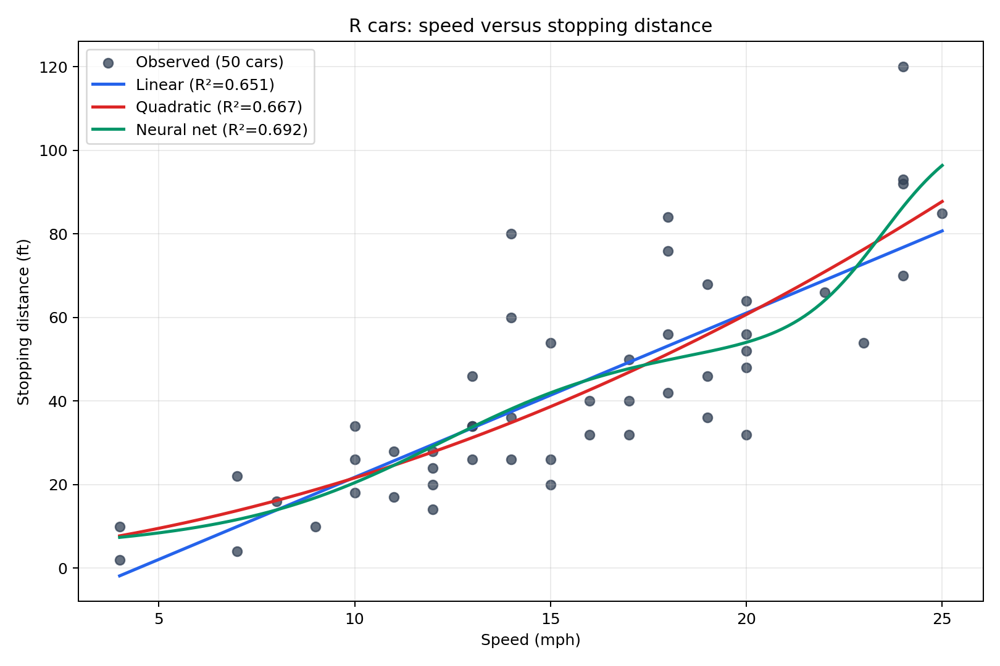

# Car Stopping Distance Regression

> 공개 자동차 데이터를 이용한 선형회귀 · 2차 다항회귀 비교 프로젝트  
> 데이터처리개론 | Python · scikit-learn · GitHub Actions

## 프로젝트 개요

자동차 속도(`speed`)와 정지거리(`dist`)의 관계를 두 가지 모델로 분석합니다. R의 공개 `cars` 데이터 50개에 동일한 평가 방식을 적용하고, 산점도 위에 두 회귀선을 그려 비교합니다.

| 항목 | 내용 |
|:--|:--|
| 데이터 | R `cars`, 관측치 50개 |
| 입력 / 출력 | 속도 `speed` (mph) → 정지거리 `dist` (ft) |
| 모델 | 선형회귀 / 2차 다항회귀 |
| 평가지표 | 결정계수 R² (학습 자료 기준) |
| 산출물 | 회귀식, R², 비교 그래프 PNG |

## 분석 결과

| 모델 | 추정 회귀식 | R² |
|:--|:--|--:|
| 선형 | `dist = -17.579095 + 3.932409 × speed` | 0.651079 |
| 2차 | `dist = 2.470138 + 0.913288 × speed + 0.099959 × speed²` | **0.667331** |

2차 모델이 관측 자료에 조금 더 잘 맞았지만, 두 R²의 차이는 약 0.0163입니다. 학습과 평가에 같은 50개 자료를 사용했으므로 **새로운 데이터에 대한 예측 성능을 검증한 결과는 아닙니다.**



## 실행 방법

### GitHub Actions에서 실행

1. 저장소 상단 **Actions** → 왼쪽 **Run regression**을 엽니다.
2. **Run workflow** → 초록색 **Run workflow**를 누릅니다.
3. 실행 완료 후 **Run regression** 단계에서 회귀식과 R²를 확인합니다.
4. 실행 상세의 **Artifacts → regression-graph**에서 생성된 그래프를 내려받습니다.

`regression_cars.py`, `cars.csv`, `requirements.txt` 또는 워크플로가 변경돼도 자동 실행됩니다.

### 로컬에서 실행

Python 3.11 이상 환경에서:

```bash
python -m pip install -r requirements.txt
python regression_cars.py
```

같은 폴더의 `cars.csv`를 읽어 회귀 결과를 출력하고, `cars_regression.png`를 저장합니다.

## 처리 흐름

`CSV 로드 → 입력·출력 분리 → 선형 모델 학습 → 속도² 특성 생성 → 2차 모델 학습 → R² 계산 → 결과 시각화`

- **선형 모델:** `dist = b₀ + b₁·speed`
- **2차 모델:** `dist = b₀ + b₁·speed + b₂·speed²`
- 두 모델 모두 관측값과 예측값의 **오차 제곱합을 최소화**하는 계수를 찾습니다. 2차 모델은 계수에 대해서는 선형이지만, 입력 속도와 출력 정지거리의 관계가 곡선입니다.

## 저장소 구성

```text
├── .github/workflows/run-regression.yml  # 수동·자동 실행
├── cars.csv                              # 공개 데이터 50개
├── cars_regression.png                   # 결과 그래프 예시
├── regression_cars.py                    # 분석 프로그램
├── requirements.txt                      # Python 의존성
└── README.md                             # 프로젝트 설명
```

## 데이터 출처 및 주의사항

- [R 공식 `cars` 설명](https://search.r-project.org/R/refmans/datasets/html/cars.html)
- [공개 CSV 원본](https://vincentarelbundock.github.io/Rdatasets/csv/datasets/cars.csv)

이 자료는 1920년대 자동차 기록입니다. 현대 자동차의 실제 안전 제동거리 산정에 사용하지 마세요.
